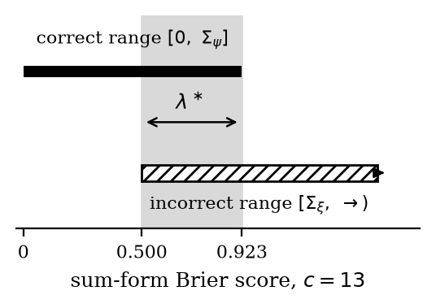
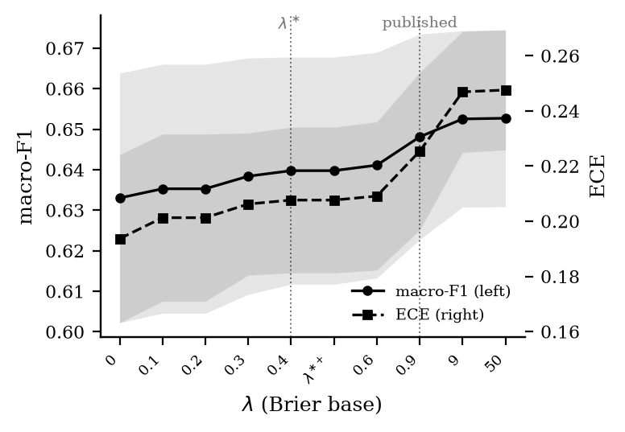

# Minimal Superior Penalties

**How small can a calibration penalty be and still guarantee that a correct
prediction always beats an incorrect one?**

[]()
[](../LICENSE)
[]()

---

> A validation metric decides which checkpoint a classifier keeps. Add a
> penalty too small and a wrong prediction can still beat a right one. Add
> a penalty too large, and you're not fixing anything -- you're just
> making every misclassification cost the same, no matter how close the
> call was. The penalty this repository's parent study published works,
> but nobody had asked: what's the *smallest* penalty that still works?
> This study derives that number in closed form, finds the published
> penalty was several times larger than it needed to be, fixes an error
> in the proof that the published penalty is well-behaved at all, and
> then goes looking for the penalty's empirical payoff -- honestly
> reporting that the search came back mostly inconclusive.

Code, pre-registered experiment design, independent verification checks,
and results for a follow-up study that revisits the penalty introduced in
the [parent repository](..): *superiority*, a pointwise guarantee that
every correctly classified forecast scores better than every incorrectly
classified one, however close the underlying probabilities are.

**Manuscript:** *Minimal Superior Penalties: Characterising and
Calibrating Decision-Aware Proper Scoring Rules* (Rouhollah Ahmadian).
Submitted independently of the parent paper and its other co-authors.

## At a glance

| | |
|---|---|
| **Closed-form gap** | The infimal penalty λ\*(c) and the published penalty are both derived in closed form for the Brier and logarithmic scores -- not just bounded, computed exactly. |
| **The correction** | The published penalty was never the minimum. For the Brier base, λ\*(c) = (c−2)/(2c) is **2.25x smaller at c=10** and **4.00x smaller at c=3** than the published (c−1)/c. |
| **The proof fix** | The published penalty's strict-propriety proof had a gap under certain tie-breaking conventions. This study closes it, and generalises the argument to an entire one-parameter family of penalties, not just the published point. |
| **The honest empirical verdict** | A pre-specified case study found the predicted effect **not statistically distinguishable from noise** at the primary class count, **non-reproducing** at a higher class count, and an intended control baseline that turned out to be **algebraically inseparable** from the effect it was meant to isolate. Reported as a central finding, not buried. |

## The gap, in one line

For `c` classes, the Brier-based penalty only needs to clear

```python
lambda_star = (c - 2) / (2 * c)        # the infimal penalty -- derived here
# published:  (c - 1) / c              # 2.25x larger at c=10, 4.00x larger at c=3
```

to guarantee superiority. Both are strictly proper under the tie convention
this study fixes; the published value simply was not the minimum.

## Figures

<table>
<tr>
<td width="50%">

<br><sub><b>Fig. 1</b> -- The supremum on correct predictions and the infimum on incorrect ones. The infimal penalty is exactly their gap.</sub>
</td>
<td width="50%">

<br><sub><b>Fig. 5</b> -- The pre-specified empirical frontier: macro-F1 against penalty size, with the primary comparison and its uncertainty.</sub>
</td>
</tr>
</table>

## Three contributions

1. **The infimal penalty.** Superiority is governed by the gap between two
   closed-form quantities -- the supremum of the base score on correct
   predictions and the infimum on incorrect predictions. This gap, the
   *infimal penalty*, is the exact threshold a penalty must clear. The
   published penalty exceeds this threshold by a provable factor and is
   one point within a strictly proper one-parameter family, not a
   uniquely determined value.

2. **A corrected propriety proof.** The strict-propriety argument for the
   published penalty had an error under certain tie-breaking conventions.
   This study corrects it and generalises the result to the whole penalty
   family under an explicit, single-valued tie-breaking convention.

3. **A pre-specified empirical case study**, reported with its limitations
   stated plainly rather than minimized: the observed effect at ten
   classes is not statistically distinguishable from noise once the
   experimental design's nesting structure is accounted for, a fifth
   regime at forty-seven classes does not reproduce it, and an intended
   no-superiority control baseline turned out, on inspection, to be
   algebraically inseparable from the family under test. The design
   limitation is reported as a central finding, not a footnote.

## Repository layout

```
minimal-superior-penalties/
├── experiments/
│   ├── config.yaml              # pre-registered experimental design
│   ├── requirements.txt
│   └── pipeline/                # data loading, models, training, scoring, selection
├── verify/                      # independent checks: superiority, propriety, published-value audit
├── figures/
│   ├── make_figures.py          # regenerates every paper figure from results/ and verify/
│   └── png/                     # the two figures shown above
└── results/                     # raw per-run metrics (ece, f1, nll, margins, ...)
```

`experiments/config.yaml` is the frozen pre-registration: the lambda grid,
datasets, regimes, outcome measures, baselines, and decision rule were all
fixed before any result was read. Later additions are recorded in the file
itself as dated `AMENDMENT` notes rather than silently edited in.

## Reproducing

```bash
pip install -r experiments/requirements.txt
python experiments/pipeline/run_experiments.py   # trains/evaluates per config.yaml, writes results/
python verify/run_all.py                         # independent checks (superiority, propriety, published value)
python figures/make_figures.py                   # regenerates figures/fig{1..5}_*.{pdf,png}
```

## Code and data availability

Everything behind every number reported in the manuscript -- experiment
configuration, training/scoring pipeline, independent verification checks,
figure generation, and raw results -- is in this folder.

## Citation

The manuscript is currently under submission; a DOI/arXiv citation will be
added here once one is available. In the meantime:

```bibtex
@unpublished{ahmadian2026minimal,
  title   = {Minimal Superior Penalties: Characterising and Calibrating
             Decision-Aware Proper Scoring Rules},
  author  = {Ahmadian, Rouhollah},
  note    = {Manuscript under submission},
  year    = {2026}
}
```

## License & contact

Released under the same [BSD license](../LICENSE) as the parent
repository. Questions and issues: open a GitHub issue, or contact
Rouhollah Ahmadian (rahmadian@aut.ac.ir).
